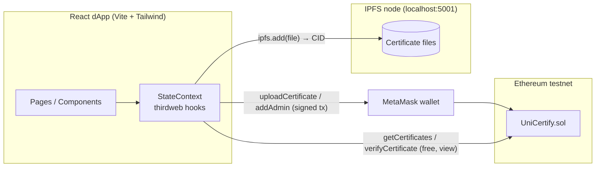

# UniCertify


-blue)

> A blockchain-based platform for issuing and verifying university certificates.
> Built as my BSc Computer Science dissertation at Swansea University (2023, First Class).

---

## Executive Summary

Academic certificates are easy to forge and slow to verify: an employer typically has to contact the issuing university and wait. **UniCertify** makes verification instant and trustless.

- A **university administrator** uploads a certificate. The file is stored on **IPFS**, which produces a content-derived hash (CID).
- That hash, plus the student's metadata, is recorded in a **Solidity smart contract** on Ethereum.
- Anyone, including an employer with no account and no gas, can later upload a certificate file and check whether its hash exists on-chain. Because the hash is derived from the file's contents, any tampering produces a different hash and verification fails.

The result is a tamper-evident registry where trust rests on cryptography and on-chain access control rather than on a single institution's database.

---

## System Architecture & Data Flow



### Issuance flow

1. The contract **owner** (the deployer) assigns a university administrator with `addAdmin(address, name, university, email)`.
2. The admin connects MetaMask and fills in the *Create a Certificate* form (student name, ID, university, issue date, image URL, certificate file).
3. The file is added to IPFS and the returned CID is passed to `uploadCertificate(...)`.
4. The contract checks the caller is an assigned admin **and** belongs to the same university as the certificate, rejects duplicate hashes, then stores the record.

### Verification flow

1. Anyone opens a certificate's detail page and uploads the file they received.
2. The app computes the file's IPFS hash and calls the read-only `verifyCertificate(hash)`.
3. The contract returns `true` only if exactly that content was previously issued. No gas is required.

### Roles

| Role | Capability |
|------|-----------|
| **Owner** | Deploys the contract; the only account that can assign admins |
| **Admin** | Uploads certificates, restricted to their own university |
| **Anyone** | Browses all certificates, views them on IPFS, verifies a file |

---

## Key Technical Features

### Smart contract (`smart-contract/contracts/UniCertifiy.sol`)

- **Modifier-based access control**: `onlyOwner`, `assignedAdmin`, `newAdmin`, and `authorisedAdmin(uni)`, which compares `keccak256` hashes of the caller's registered university and the certificate's university so an admin cannot issue on behalf of another institution.
- **Duplicate prevention**: a `mapping(string => bool)` keyed by IPFS hash makes each document issuable once.
- **Gas-free reads**: `getCertificates()` and `verifyCertificate()` are `view` functions.
- **Compact on-chain footprint**: bulky binary data lives on IPFS; only metadata and the CID are on-chain.
- Admin and certificate counters are exposed publicly (`countAdmins`, `countCertificates`).

### Frontend (`frontend/`)

- **React 18 + React Router** SPA with a responsive sidebar/navbar layout (Tailwind CSS, dark theme).
- **thirdweb React SDK** for wallet connection (MetaMask) and contract reads/writes.
- **QR code generation** for each certificate (links to its IPFS URL) via `qrcode`.
- **In-browser verification**: drag in a file, hash it, check it against the chain.
- Certificate browsing: *All Certificates* dashboard and a per-wallet *My Certificates* page.
- Browser `Buffer` support through `vite-plugin-node-polyfills`.

### Project layout

```
UniCertify-Project/
├── smart-contract/          # Hardhat + thirdweb contract project
│   ├── contracts/UniCertifiy.sol
│   ├── hardhat.config.js
│   └── deployArgs.json
└── frontend/                # Vite + React dApp
    └── src/
        ├── context/         # Web3 state, IPFS and contract calls
        ├── pages/           # Home, Profile, AddAdmin, UploadCertificate, CertificateDetails
        ├── components/      # Navbar, Sidebar, CertCard, FormField, Loader, ...
        └── constants/       # Contract address, nav links
```

---

## Testing & Quality Assurance

There is **no automated test suite** in this repository. The contract and UI were verified manually against a public testnet during the dissertation. If you extend the project, the first priorities would be a Hardhat/Mocha test suite for the access-control rules (owner-only admin assignment, cross-university issuance rejected, duplicate hash rejected) and component tests for the verification flow.

---

## Deployment & Setup

> **Heads-up:** this project targets the **Goerli** testnet, which has since been deprecated and shut down. The instructions below describe the original setup; to run it today you must switch to a live testnet (e.g. Sepolia) and redeploy. See *Reviving the project* below.

### Prerequisites

- Node.js 16+ and npm / yarn
- MetaMask browser extension with testnet funds
- A local [IPFS](https://docs.ipfs.tech/install/) daemon listening on `localhost:5001` with CORS enabled for the dev server origin

### 1. Smart contract

```bash
cd smart-contract
npm install
echo "PRIVATE_KEY=<your-deployer-key-without-0x>" > .env
npx thirdweb@latest deploy
```

Copy the deployed address into `frontend/src/constants/index.js` (`CONTRACT_ADDRESS`).

### 2. Frontend

```bash
cd frontend
npm install
npm run dev
```

Open the printed local URL, connect MetaMask, and (as the deployer) assign an admin from the *Assign an Admin* page before uploading certificates.

### Reviving the project

- Change `activeChain` in `frontend/src/main.jsx` to a live network and redeploy the contract there.
- Fix the `networks` block in `hardhat.config.js` (it is currently nested inside `solidity`).
- Migrate from `@thirdweb-dev/*` v3 to the current thirdweb SDK.
- Replace the local-node IPFS client with a pinning service.

---

## Known Issues & Technical Debt

This is a three-year-old student project, and it shows. Documented honestly so nobody (including me) mistakes it for production code:

**Bugs**

- `createCertificate` and `checkCertificate` call `addCertToIPFS()` **without `await`**, so a Promise rather than the hash is passed to the contract.
- `getUserCertificates` filters on `certificate.owner`, but the parsed records never include that field, so *My Certificates* is always empty. (The contract stores `creator`.)
- *View Certificate on IPFS* opens a blank tab: it calls `window.open` with a stale state value.
- Verification calls `ipfs.add`, which pins the uploaded file as a side effect; a hash-only computation would be the right approach.
- QR code generation runs in the render body instead of an effect.
- The yearly-percentage boxes on the detail page are hardcoded placeholder values; the navbar search box is non-functional.

**Design limitations**

- No certificate **revocation**, no admin removal, and no events emitted for indexing.
- Student name and ID are stored in plaintext on a public chain. Acceptable for a demo, but a real deployment would need a privacy/GDPR design (e.g. storing only hashes on-chain).
- Strings are stored on-chain (costly), `uint16` counters cap at 65,535 records, and `getCertificates()` returns the whole array with no pagination.
- Hardhat config misplaces `networks`, and IPFS depends on a local node, so the app cannot work as a hosted site as built.

**Deprecated dependencies**: thirdweb SDK v3, Goerli network, `ipfs-http-client`, Vite 3, Solidity 0.8.9.

---

## Credits & License

The frontend scaffolding and UI structure are adapted from the **JavaScript Mastery** crowdfunding dApp tutorial by Adrian Hajdin ([video](https://www.youtube.com/watch?v=BDCT6TYLYdI) · [source repo](https://github.com/adrianhajdin/project_crowdfunding)), built on the thirdweb framework. The smart contract, the certificate-issuance and verification logic, the IPFS integration, and the system design are my own dissertation work.

The frontend retains the Apache-2.0 license inherited from the thirdweb starter template (see `frontend/LICENSE.md`). The smart contract is marked `UNLICENSED`.

**Author:** Ahmed Khatib, BSc Computer Science, Swansea University (2023)
